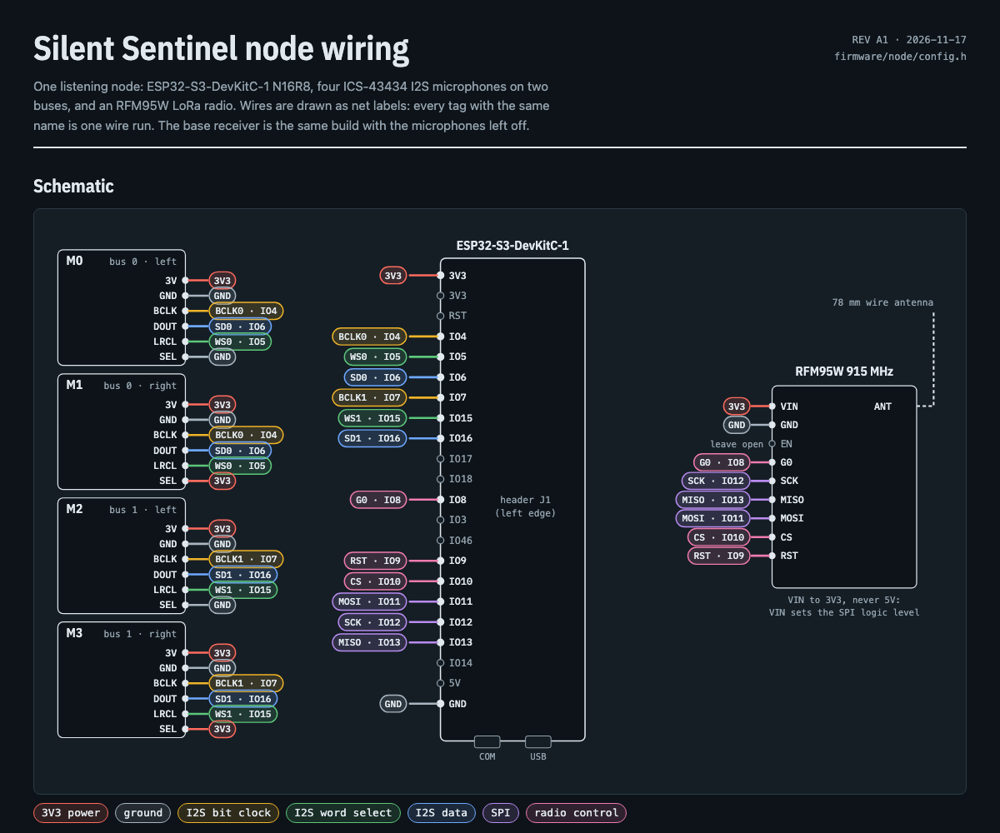

# Node wiring (Rev A1)

Full sheet with wiring tables, build order and placement notes: [PDF](Silent-Sentinel-Node-Wiring.pdf) · [HTML](wiring.html) (download and open in a browser).
Pins come from `firmware/node/config.h`; regenerate with `python docs/make_wiring.py` after changing them.
